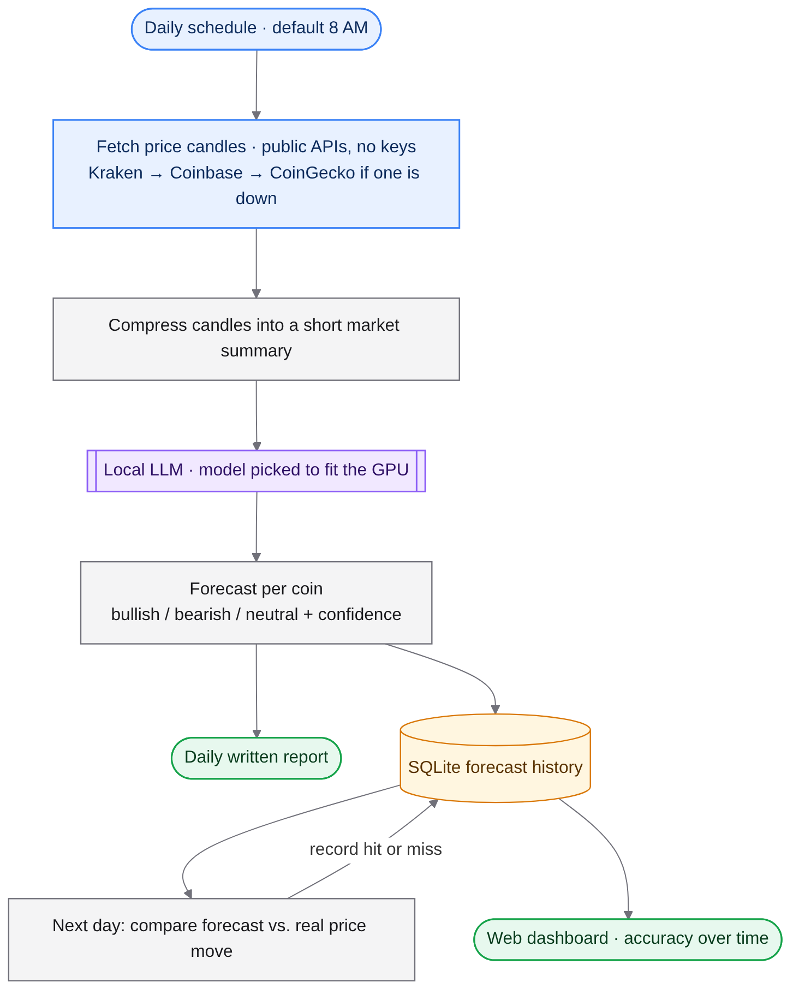
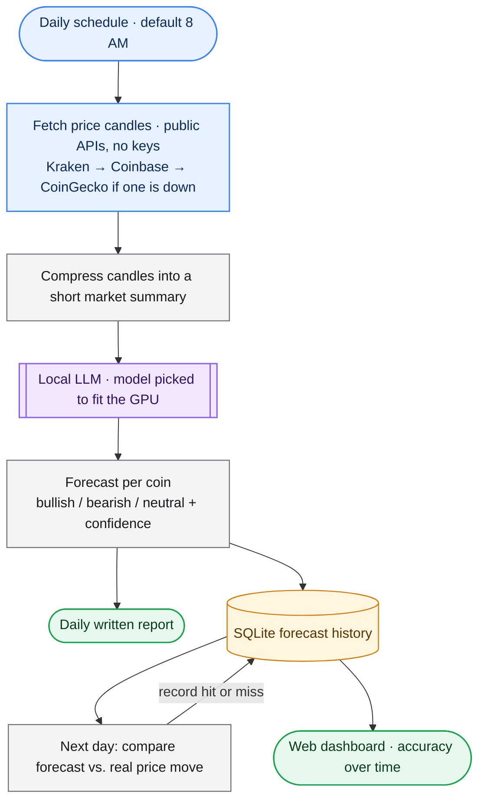

# LLM Market Forecaster

> 📘 New here? Start with **[READ_THIS_OVERVIEW.md](READ_THIS_OVERVIEW.md)** for a plain-English walkthrough.

A daily crypto market forecaster that runs on a local model, writes plain-English reports, and grades its own predictions the next day.

## Workflow



> **Diagram key:** blue = input · purple = AI model · grey = processing · amber = storage · red = safety / guard rail · green = output

<details><summary>Diagram source (renders on GitHub)</summary>


</details>

## What it does
- Pulls 1h/4h/1d price candles from public exchange APIs — no account or key needed — with automatic fallback if one source is down.
- Shrinks raw price data into a short structured summary the model can reason about.
- Asks a local model for a direction call and confidence per coin, and saves a readable report.
- Checks yesterday's calls against what actually happened and tracks hit rate.
- Shows everything on a small local dashboard.

## What this project demonstrates
- Scheduled LLM pipeline with data-source failover
- Prompt design for structured, parseable model output
- Self-evaluation loop (prediction → outcome → accuracy)
- GPU-aware model selection

## Quick start
1. Install Ollama and pull a model (e.g. `qwen2.5:7b`).
2. `bash install.sh` (or `pip install -r requirements.txt`)
3. `python run.py` — dashboard at `http://localhost:5050`. Edit `config.yaml` for coins and schedule.

## Project layout
```
run.py                 ← scheduler + dashboard
config.yaml            ← coins, schedule, model
skill/market_data.py   ← fetch + compress
skill/llm_analyst.py   ← prompts + parsing
skill/accuracy.py      ← grades past forecasts
skill/database.py      ← SQLite storage
dashboard/             ← status page
```

## Notes
Analysis only. It places no trades and isn't financial advice.

## License
MIT — see [LICENSE](LICENSE).
